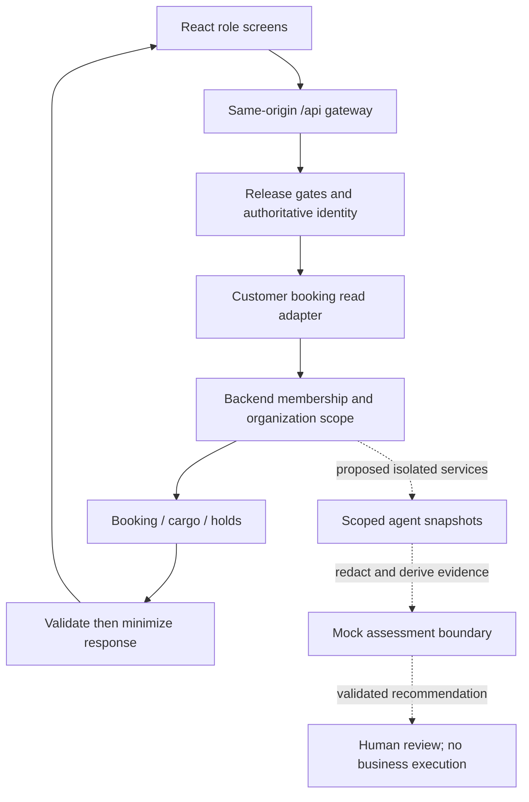

# Database, agent and frontend alignment 0.1.3

Status: **AUTHORED / OFFLINE CHECKED / NOT DEPLOYED**. Source is the retained October 29 published export, not the current live database. No schema changes are applied. Native syntax validation, installation and runtime verification are NOT_RUN.

`schema-catalog.json` records all 33 exported tables, 465 field declarations, enums, declared table references and normalized source hashes. A declared table reference is not proof of a physical foreign key. Xano optional/default markers are preserved verbatim; HTTP nullability still needs runtime verification. The crosswalk is absent from this export; its contents cannot be inferred.

`agent-dataflow.json` maps each of the five requested agents to minimum server-side source fields and explicit tenant/join rules. Those fields are NOT a model prompt: only bounded, server-derived evidence codes and opaque IDs may cross the model boundary. Finance fields remain restricted and need an approved unit/rounding policy. `schema-change-proposal.json` records concrete incompatibilities and a dedicated assessment/recommendation record design for review. It is not an executable migration.

## Frontend to backend flow

Solid edges describe existing code paths, still subject to release gates and unverified Xano runtime. Dotted edges are proposals; no agent HTTP route, native persistence or UI agent integration exists.

| Surface | Database and response | Current boundary / remaining work |
|---|---|---|
| Identity | user, organization, organization_member | Server-derived identity required. Registration remains locally blocked. Native onboarding approval does not fit existing approval enum. |
| Customer bookings | customer_booking, cargo_detail, order_holds | Adapter checks customer organization, status and version; returns limited booking fields and detail counts. Customer paging remains curPage/nextPage upstream, page/nextPage in browser. |
| Owner/driver | trip, driver_profile, vehicle | Candidate readers require vendor scope and driver restriction. No released frontend operational adapter. |
| Admin | explicit customer organization plus membership grant | Candidate minimal projection; no blanket tenant enumeration or financial access. Proposed paging differs from customer paging. |
| OMS | booking and cargo | Assess completeness only; expected booking version required. |
| IMS | vehicle, availability, reservations | Vendor scope across vehicle and driver; customer booking link grants no customer visibility. Atomic reservations remain unverified. |
| TMS | trip, stops, incidents | Vendor and driver scope; joins must match selected trip. No dispatch tool. |
| Verification | POD and compliance documents | Resolve polymorphic owner before authorization. Never send OTPs, private keys, images or contacts to a model. |
| Finance/Compliance | payments, refunds, settlements | Explicit finance grant and separate customer/vendor projections. No money execution. |

## Schema changes requiring review

1. Existing agent enums are booking_ingestion_agent, matching_dispatch_agent, tracking_telemetry_agent, exception_incident_agent and settlement_reconciliation_agent. None is an exact requested ID. No aliases are approved; Verification cannot be presumed equivalent to exception handling.
2. Agent execution/decision tables lack explicit organization, authenticated actor and source snapshot/version fields. A reviewed dedicated assessment schema would preserve legacy history and record these requirements.
3. Existing approval categories cover financial/dispatch/compliance overrides, not general agent review or registration. A recommendation review must never imply permission to execute an operation.
4. Most source tables lack a version field. A transactionally consistent snapshot and stale-result rejection must be designed and tested; synthetic default versions are forbidden.
5. Application checks must enforce cross-tenant joins and polymorphic document ownership. Foreign-key declarations cannot establish authorization.

## Verification and release dependencies

`inventory-reconciliation.json` compares the supplied 85 symbolic identities with the retained 84-resource export. Only `table:zippy_db_crosswalk_49_to_xano_33` is absent; there are no export-only identities. Display-name aliases are explicit. Most endpoint methods were omitted from the supplied reference and are inferred from retained source, not independently confirmed. `published-paths.json` is the requested minimal handoff payload.

All 14 safety-set files occur among the 41 retained published/draft differences. Their retained published sources have empty stacks. No offline/safe-mode/disabled marker is found by the recorded lexical scan in either copy; this scan cannot establish whether a semantically equivalent guard exists. The October 29 differences cannot prove incorporation of later safety drafts. R6 in the supplied receipt is too strong: equal hashes alone cannot prove that a guard exists or is reachable. Current VFS source for the 14 guards and the claimed D-1–D-3 revisions is still required; do not bulk-import these older drafts.

Run `npm run test:server` from frontend. The schema alignment tests check source completeness/hashes, projection fields, legacy incompatibilities and the actual customer adapter's redaction/tenant denial. They do not test native agent reads or enforce the proposed join rules in Xano.

Remaining: current VFS identity/content comparison, independently verified execution target, reviewed native schema/migrations, transactional identity/onboarding, all-writer version/idempotency/lease checks, source snapshot rules, native scoped readers, agent evidence derivation/persistence, role-specific review UI and negative/runtime acceptance tests. Keep all operational releases blocked. No provider calls, live writes, schedules or autonomous execution are authorized.
